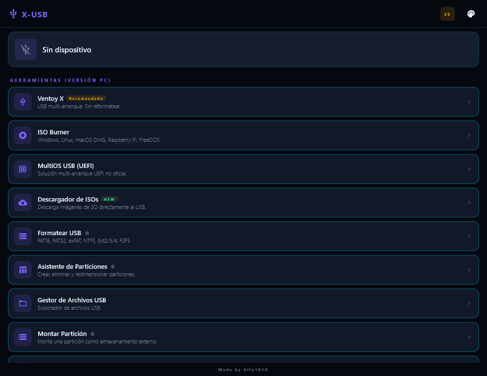
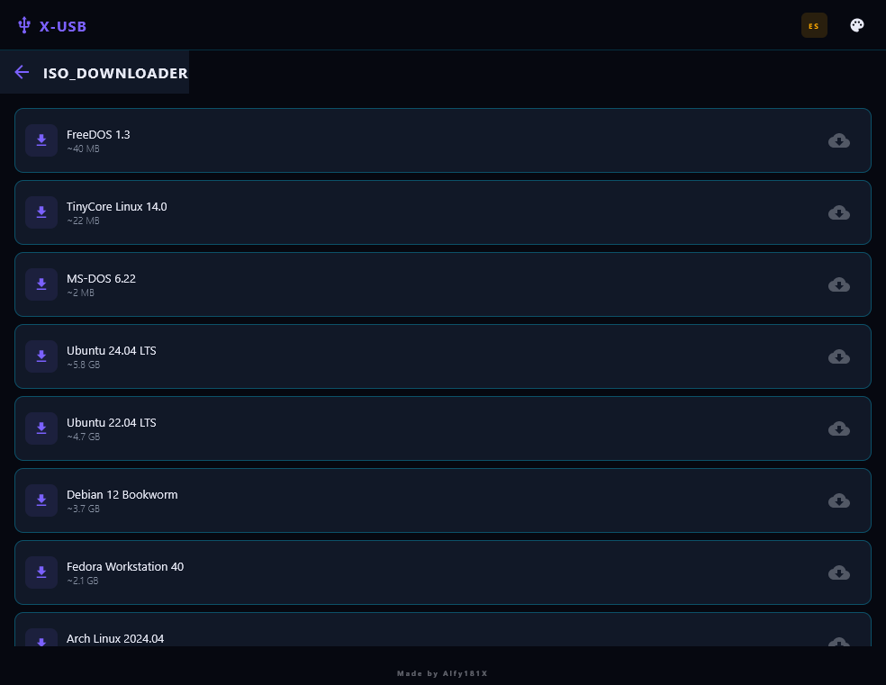

# 🚀 X-USB: The Ultimate Multiplatform USB Suite
**Hecho por KCRooty (Core) · [Static Forge](https://staticforge.me)**

**Página del proyecto:** [staticforge.me](https://staticforge.me/#proyectos)

## Capturas

*Versión de escritorio (Windows/Linux, Compose Multiplatform): Ventoy X, ISO Burner, MultiOS USB, Descargador de ISOs, formateo y gestión de particiones.*

*Catálogo integrado de distribuciones listas para descargar directamente al USB.*

¡Gestiona tus dispositivos USB como un profesional! X-USB es una suite completa de herramientas para manejar pendrives, discos externos e imágenes de sistema, diseñada con una estética **Cyberpunk** única y optimizada para alto rendimiento.

Manage your USB devices like a pro! X-USB is a complete suite of tools to handle flash drives, external disks, and system images, designed with a unique **Cyberpunk** aesthetic and optimized for high performance.

---

## 🛠️ Funciones Principales / Main Features

### 💿 ISO & Bootable
*   🔥 **ISO Burner**: Graba imágenes ISO/IMG/DMG en segundos (Win, Linux, macOS).
*   🐧 **Ventoy X**: Instala el motor Ventoy con interfaz personalizada para arrancar múltiples ISOs sin formatear.
*   💻 **MultiOS (UEFI)**: Crea dispositivos de arranque compatibles con sistemas UEFI modernos.

### 🧼 Limpieza y Formato / Wipe & Format
*   ✨ **Format USB**: Formatea en FAT16, FAT32, exFAT, NTFS, Ext2/3/4 y F2FS.
*   💀 **Secure Wipe**: Borrado seguro de nivel industrial para eliminar rastro de datos y particiones.

### 🧩 Gestión Avanzada / Advanced Management
*   🗺️ **Partition Wizard**: Visualiza y gestiona las particiones de tu unidad.
*   🔗 **Partition Mounter**: Monta particiones directamente en tu dispositivo.
*   💾 **Backup & Restore**: Crea imágenes espejo (.img) de tus unidades y restáuralas cuando quieras.

### 🌍 Extras
*   📥 **ISO Downloader**: Catálogo integrado con los sistemas operativos más populares (Ubuntu, Windows 11, Arch, etc.) listos para descargar.
*   🎮 **PS2 USB Utils**: Herramientas específicas para gestionar juegos de PlayStation 2 en USB.
*   📂 **USB File Manager**: Explorador de archivos integrado.

---

## 🎨 Temas y Estética / Theming & Design
X-USB incluye 3 temas visuales inspirados en interfaces futuristas:
1.  **Dark Purple (Cyberpunk)**: El tema principal con neones morados y detalles en oro.
2.  **Light Mode**: Una versión limpia y profesional.
3.  **Blue + Yellow**: Contraste alto para máxima legibilidad.

---

## 🚀 Instalación / Installation

### Android 📱
1.  Descarga el **APK** desde la sección de [Releases](https://github.com/KCRooty/X-USB/releases).
2.  Requiere acceso **Root** para funciones de bajo nivel (formato, particiones).

### PC (Windows / Linux) 💻
1.  Descarga el ejecutable para tu sistema.
2.  En Linux (Arch, Fedora, Ubuntu), asegúrate de tener permisos de superusuario (`sudo`).

---

**Made with ❤️ by KCRooty (Core) · Static Forge**
