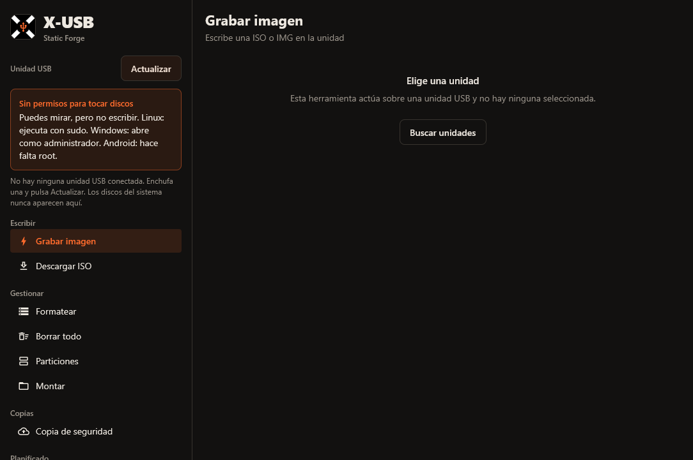
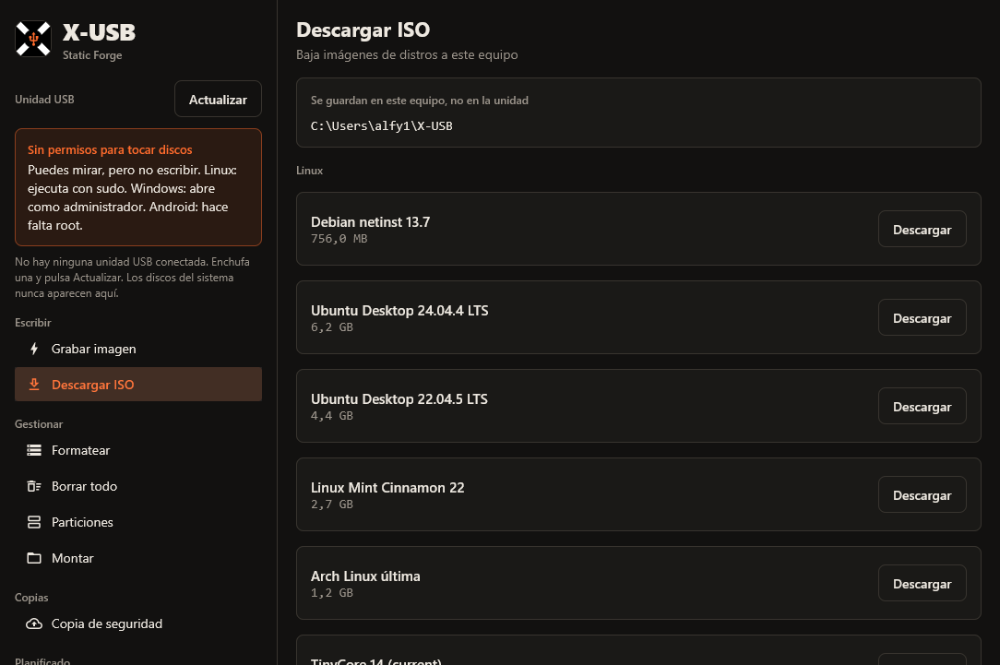

# X-USB

Herramienta para pendrives y discos USB, en **Android, Linux y Windows**, con la misma interfaz y la misma lógica en las tres: formatear, grabar imágenes, hacer copias, gestionar particiones y borrar.

Es de [Static Forge](https://staticforge.me). Libre (GPL-3.0), gratis, sin anuncios y sin telemetría.

## Qué hace (y dónde)

| Función | Linux | Windows | Android |
|---|---|---|---|
| Listar USB conectados | ✅ | ✅ | ✅ (sin root) |
| Formatear FAT32 | ✅ | ✅ (≤ 32 GB) | ✅ (sin root, cualquier tamaño hasta 2 TiB) |
| Formatear FAT16, exFAT, NTFS | ✅ | ✅ | ✅ (root + herramientas) |
| Formatear ext2/3/4, F2FS | ✅ | ❌ | ✅ (root + herramientas) |
| Grabar ISO/IMG en bruto | ✅ | ✅ | ✅ (sin root, con verificación) |
| Copia de seguridad y restauración | ✅ | ✅ | ✅ (sin root) |
| Borrado | ✅ completo | ⚠️ rápido (tablas y firmas) | ✅ completo (sin root) |
| Particiones: ver | ✅ | ✅ | ✅ (sin root, MBR y GPT) |
| Particiones: crear, borrar | ✅ | ✅ | ✅ (root + herramientas) |
| Convertir MBR ⇄ GPT sin perder datos | ✅ | ❌ | ✅ (root + herramientas) |
| BIN → ISO, descargador de ISOs | ✅ | ✅ | ✅ |
| Ventoy | ❌ aún | ❌ aún | ❌ aún |

- ✅ = implementado. Lo que se ha ejecutado de verdad y lo que solo compila está detallado en [CHANGELOG.md](CHANGELOG.md).
- Lo que no funciona en una plataforma devuelve un error claro; nada finge haber terminado.

## Seguridad

Antes de escribir, cada plataforma comprueba que el destino es un **disco USB** y **no** el disco del sistema ni uno de arranque. Aun así, escribir en un disco es destructivo: comprueba siempre qué dispositivo has elegido.

## Requisitos

- **Linux**: `parted`, `gdisk` (sgdisk), `dosfstools`, `exfatprogs`, `ntfs-3g`, `f2fs-tools` según lo que uses; permisos de administrador (se piden con `pkexec`).
- **Windows 10/11**: ejecutar como **administrador** para modificar discos. Java 21 si usas el `.jar`.
- **Android 8.0+** con **USB OTG**. Listar, grabar, borrar, copiar, restaurar, formatear en FAT32 y ver las particiones funcionan **sin root**: la app habla con el pendrive por USB Host (con [libaums](https://github.com/magnusja/libaums)) y solo pide que aceptes el aviso de permiso de Android. Los demás formatos, crear o borrar particiones y Ventoy necesitan todavía root y las herramientas `parted`, `sgdisk` y `mkfs.*`, que Android no trae.

## Capturas

Escritorio (Windows, tema oscuro):





## Instalar

Descarga desde [Releases](https://github.com/KCRooty/X-USB/releases): APK (Android), `.deb` (Linux) y `.jar` (Windows, `java -jar`).

## Compilar

JDK 21 y el SDK de Android (plataforma 34).

```sh
./gradlew :app:assembleDebug                  # APK
./gradlew :desktop:run                        # escritorio
./gradlew :desktop:packageUberJarForCurrentOS # JAR portable
```

## Estructura

- `common/` — interfaz (Compose Multiplatform) y lógica compartida (`ShellBackend`, `JvmOps`).
- `desktop/` — Linux y Windows (`LinuxBackend`, `WindowsBackend`).
- `app/` — Android (`AndroidBackend`: USB Host sin root para grabar, borrar y copiar; root vía libsu para lo demás).

## Licencia

[GPL-3.0](LICENSE). Hecho por KCRooty en Static Forge.
